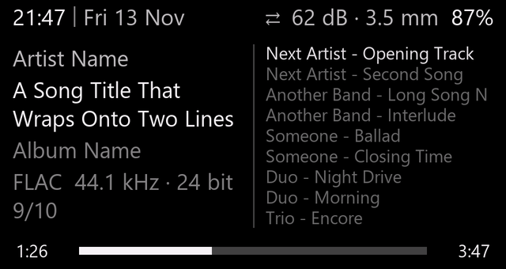
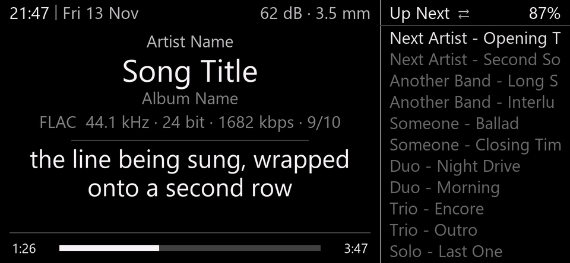
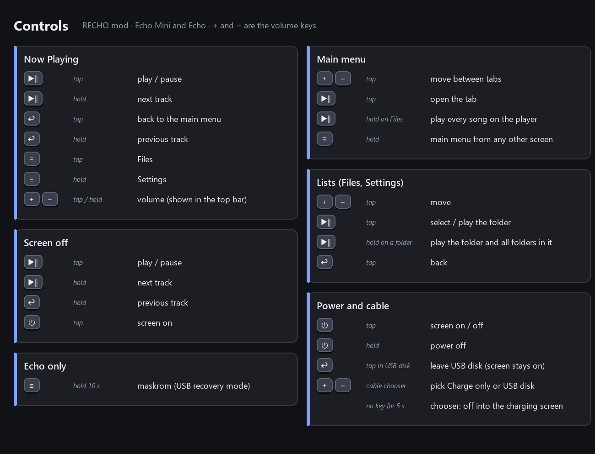

# recho-echo-mod

Binary patches for **[RECHO](https://recho.atzkey.workers.dev/) 0.10.1** (build `2d11bdcd`), an independent
custom firmware for the FiiO / Snowsky **Echo Mini**, plus a port of it to the full-size **Snowsky Echo**.
RECHO is not made by FiiO or Snowsky; they make the players and their stock firmware.

Everything here is a script, C source or document. **No firmware image is included.** You patch your
own copy of RECHO 0.10.1 and get a new image that a verifier checks byte by byte before you flash it.

<table>
<tr>
<td width="50%"><br><sub><b>Echo Mini</b>: song on the left, Up Next on the right</sub></td>
<td width="50%"><br><sub><b>Echo</b>: big title, file details, live lyrics, Up Next column</sub></td>
</tr>
</table>

## Built on RECHO

This project is **RECHO with a layer of patches on top**, not a firmware of its own. Everything that
makes the player a player is RECHO's work: audio decoding and gapless playback, the file system and
SD card, the queue and its shuffle order, tags, settings, USB disk mode, the updater, power
management, the display driver, the fonts and icons, and the Files, Settings and menu screens. The
mod replaces how a few screens look, remaps some keys and adds small features, and it does that by
calling RECHO's own routines.

| | Echo Mini image | Echo image |
|---|---:|---:|
| bytes that differ from RECHO 0.10.1 | 28,715 of 5,242,884 (0.55 %) | 34,136 of 5,242,884 (0.65 %) |
| of which the mod's own code (in a free area of RECHO's image) | 16,147 | 21,519 |
| of which two RECHO modules blanked (Spectrum, Debug) | 11,516 | 11,516 |
| RECHO routines the mod's code calls | 49 | 53 |

Even the new screens are drawn with RECHO's text and rectangle routines and RECHO's fonts; the
boot screen's 32 glyphs are copied out of RECHO's large font at build time. The full-size Echo port
runs RECHO's unchanged player on different hardware. RECHO is the work of its author, who is not
involved in this project and has not endorsed it. If you like what the players do, the credit
belongs to RECHO first: get it from [its site](https://recho.atzkey.workers.dev/).

> [!WARNING]
> **Use at your own risk.** Flashing custom firmware can leave a player unable to start until it is
> recovered over USB. Read [docs/10-install-and-recovery.md](docs/10-install-and-recovery.md) before
> the first flash and keep the recovery tools ready.

## What you get

| | Echo Mini | Echo |
|---|:---:|:---:|
| **Now Playing** redrawn: artist, song, album, file details with queue position (`9/10`) | ✅ | ✅ |
| Up Next list in play order (shuffle included) | ✅ right half | ✅ side column |
| Song title doubled when it fits, live lyrics from `.lrc` files | | ✅ |
| Volume in the top bar before the output (`62 dB · 3.5 mm`), shown from 0 dB | ✅ | ✅ |
| Battery % green while charging, amber / red when low | ✅ top bar | ✅ Up Next |
| Pixel-art main menu: Files · USB disk · Now Playing · Bluetooth · Settings | ✅ | ✅ |
| **Hold ▶‖ on Files** in the main menu: play every song | ✅ | ✅ |
| **↩ leaves USB disk** (the screen stays on) | ✅ | ✅ |
| Terminal-style boot screen in RECHO's own font | ✅ | ✅ |
| Off-state charging screen and charging animation | ✅ | ✅ |
| Cable chooser *Charge only / USB disk*, idle 5 s = power off into the charging screen | ✅ | ✅ |
| Shorter menu and Settings; unused screens, modules and icons removed | ✅ | ✅ |
| Button remap (↩ = back, hold ≡ = Settings) | ✅ | ✅ |
| ST7796S panel, Echo pin map, RECHO's updater under Echo-only names, maskrom hatch | | ✅ |
| Bluetooth pairing (audio not working yet, see [docs/12](docs/12-bluetooth.md)) | 🚧 | 🚧 |

**How to use it:** [docs/controls.md](docs/controls.md), with a printable cheat sheet.

<a href="docs/controls.md"></a>

## Quick start

Requirements: Python 3.10+, Pillow (icons and doc pictures), the Arm GNU Toolchain
(`arm-none-eabi-gcc` 12.x) and bash (Git for Windows' bash works).

```bash
# 1. compile the hook code that goes into the firmware's code cave
tools/build_hooks.sh            # Echo Mini  -> build/hooks.*
tools/build_hooks.sh echo       # full Echo  -> build/hooks-echo.*

# 2. patch your copy of RECHO 0.10.1 (it refuses any other build, and a stale hook build)
python tools/patch_recho.py RECHO-0.10.1.IMG out/HIFIEC90.IMG --icons icons/mod          # Echo Mini
python tools/patch_recho.py RECHO-0.10.1.IMG out/RECHOECH.IMG --icons icons/mod --echo   # full Echo

# 3. check every changed byte against the original before flashing
python tools/verify_image.py RECHO-0.10.1.IMG out/HIFIEC90.IMG
python tools/verify_image.py RECHO-0.10.1.IMG out/RECHOECH.IMG --echo
```

Set `ARM=/path/to/arm-none-eabi/bin` and `OBJDUMP=/path/to/arm-none-eabi-objdump` if the toolchain is
not in the default Windows location. The patcher refuses a `build/hooks*.bin` older than `patches/`,
so a failed build can't slip old code into an image. The verifier compares the cave bytes with the
build.

`--icons icons/mod` adds the 15 glyphs this mod redraws (battery set, play / pause, …); leave it out
to keep RECHO's ([docs/05-icons.md](docs/05-icons.md)). With the same toolchain the result is
byte-identical to the released builds; [docs/13](docs/13-reverse-engineering.md#replicating-a-build).
The first build needs `RECHO_IMG=/path/to/RECHO-0.10.1.IMG tools/build_hooks.sh`: it extracts the
boot screen's 32 glyphs from your image into `build/boot_font.h` (`tools/make_boot_font.py`).
`tools/render_docs.py` redraws the pictures in `docs/img/`.

## Installing

| Player | File name on the player | How |
|---|---|---|
| Echo Mini | `HIFIEC90.IMG` | copy to the top level of the internal drive, eject, unplug, restart |
| Echo (from RECHO) | `RECHOECH.IMG` | same; RECHO's updater installs it and deletes the file |
| Echo (from FiiO firmware) | `ECHOVnnn.IMG` | first install only, see [docs/10](docs/10-install-and-recovery.md) |

> [!CAUTION]
> Never put the Mini's image on the Echo or the other way round. The file names differ on purpose.

Details, maskrom recovery and the exact commands: [docs/10-install-and-recovery.md](docs/10-install-and-recovery.md).

## Documentation

| | Doc | Contents |
|---|---|---|
| 🎮 | [Controls](docs/controls.md) | **Start here.** Buttons on every screen, the screens, cheat sheet |
| 📦 | [01 Firmware format](docs/01-firmware-format.md) | RKnanoFW container, load rows, CRC, SFMD modules, part chain, sealing |
| 🗺️ | [02 RECHO map](docs/02-recho-map.md) | Every RECHO routine and variable the patches use |
| 🔧 | [03 Patches](docs/03-mini-patches.md) | Every patch site: original bytes, new bytes, reason |
| 🔌 | [04 Echo port](docs/04-echo-port.md) | Hardware differences, panel, pins, updater, display fallback |
| 🖼️ | [05 Icons](docs/05-icons.md) | Icon pack, glyph codes, replacing and removing glyphs |
| 📺 | [06 User interface](docs/06-echo-ui.md) | Now Playing, Up Next, player strip, lyrics, menu, boot screen |
| ⌨️ | [07 Buttons (internals)](docs/07-buttons.md) | Key ids and events, how each remap is wired |
| 🧠 | [08 Memory and code cave](docs/08-memory.md) | RAM map, free RAM, cave rules and space left |
| ✅ | [09 Verifier](docs/09-verifier.md) | Every check `verify_image.py` runs and why |
| 🛟 | [10 Install and recovery](docs/10-install-and-recovery.md) | Flashing, maskrom, rkdeveloptool, Zadig |
| 🧩 | [11 Tweaking guide](docs/11-tweaking.md) | How to add your own patch safely |
| 🎧 | [12 Bluetooth](docs/12-bluetooth.md) | Bluetooth work in progress and the hardware facts |
| 🔬 | [13 Reverse engineering](docs/13-reverse-engineering.md) | Method, scripts (`tools/re/`), every finding with its evidence, how to replicate a build |
| 📝 | [Echo port research notes](docs/research/echo-port-notes.md) | Sources, hardware facts Mini vs Echo, FiiO updater, RECHO RAM map |
| 📜 | [CHANGELOG](docs/CHANGELOG.md) | Build history: Echo Mini v1–v39, Echo stages 1–43 |

## Repository layout

```
patches/   C code linked into the firmware's free code cave (0x0306E000..)
tools/     patcher, verifier, image and icon tools, hook build, boot font and doc pictures
tools/re/  reverse-engineering helpers: dump + disassemble, callers, glyph uses, fonts
icons/mod/ the 15 glyphs the mod redraws (everything else stays RECHO's)
tests/     host-side render test for the charging screen
docs/      everything above; docs/img/ holds the generated pictures
```

## Credits and licences

See [NOTICE.md](NOTICE.md). RECHO is © its author ([recho.atzkey.workers.dev](https://recho.atzkey.workers.dev/));
the players and their stock firmware are © FiiO / Snowsky. Facts about the full-size Echo (panel
init table, pin map, maskrom procedure) were learnt from the Podium project (GPL). This repository's
own code and documents are MIT licensed ([LICENSE](LICENSE)).
