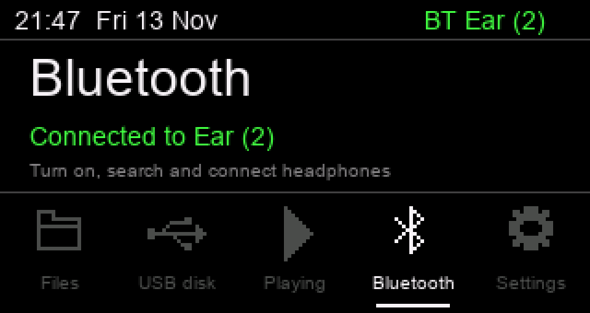

# 06 · Echo user interface

RECHO only knows a 320 × 170 frame buffer. On the Echo's 480 × 222 panel the port shows that buffer
where RECHO always drew it. It draws everything else straight into panel memory, between RECHO's
frames.

```
 panel rows 49..218    cols 0..319: RECHO's frame buffer      cols 320..479: Up Next (rows 49..270)
 rows 219..270         cols 0..319: player strip (two 26-row lines)
```

## How the port draws outside RECHO's picture

RECHO's drawing routines only write to the frame buffer. To use them for the extra areas, the port
**borrows** a corner of it:

1. `push_idle()` (`0x306B534`) waits until no DMA band is in flight.
2. `ui_borrow(w, h)` copies the frame buffer's top-left w × h pixels (≤ 8,320 px) to a strip in
   free RAM, clips RECHO's routines to that corner and clears it.
3. Draw with RECHO's own `fill_rect` / `draw_text` (same font, same glyphs).
4. `ui_return(x, y, w, h)` sends those pixels to the panel window (x, y) and puts RECHO's pixels
   and clip rectangle back.

All of this runs in the main loop from the POWER tick wrapper, never in an interrupt, and never
while RECHO is drawing. Each pass does at most one line or one cell. With the screen off
(`0x03006174` = 0) nothing is drawn; everything is marked stale and redrawn on wake.

## Up Next (`patches/echo_sidebar.c`)

- **Header:** "Up Next", the play-mode glyph (`U+E003`–`E006`, `E02B`) and battery %. The % is
  green while charging, amber at 35 % or less, red at 15 % or less.
- **Lines:** the next 8 tracks, in the order RECHO will play them. The tick walks
  `0x3065FE4(queue, cur, mode, 0)` from the current entry. That is the same pure function the player
  uses (shuffle permutation included), so the list matches.
- **Names:** from `0x3064B64`, the player's own lookup: one 36-byte index read plus the M3U line.
  Extensions are hidden.
- **When it redraws:** when the queue, current track, mode, count, seed or pass changes, after
  0.3 s of quiet, one line per main-loop pass.
- **Storage safety:** before USB-disk mode RECHO clears queue-active and closes the store
  (`0x305BC30`), so the sidebar never reads storage while the PC owns it.

## Now Playing (`patches/ui_np.c`, `np_draw`, both players)

Module m45's draw entry `0x307A1F0` is replaced by `b.w np_draw`. The rest of m45 (key handler,
labels) stays. `np_draw` draws the whole 320 × 170 frame buffer from RECHO's player data
([02-recho-map.md](02-recho-map.md)):

| Element | Source |
|---|---|
| top bar: `21:47 Thu 12 Nov` · `1 / 9` | clock (below), queue index / count |
| `Artist - Song` centred, artist light grey | tag record `0x305A8F8`, falls back to file / folder name |
| album, grey | tag record |
| ▶, or red ❚❚ PAUSED, or the volume for 2 s after a change | `0x3057BD0`, `0x030041D0`, `0x0303AB8C` |
| progress bar and times; red when paused | `0x3057BE4`, length from the format record |
| `FLAC · 44.1 kHz · 24 bit · 3.5 mm · RG −3.2 dB` | format record, file extension, GPIO2.8, `0x3057DB4/DC0` |

RECHO asks for a redraw every second while playing. The clock code asks once a minute so the time
stays right while paused.

## Cable chooser (`usb_draw`, both players)

The `USBSEL` screen's draw pointer (`0x3060AD4`, was `0x3059EDD`) → `usb_draw`. Two halves in RECHO's
style: Charge only (battery glyph, countdown from `0x030399BC`) and USB disk (drive glyph). The
cursor at `0x030041B4` picks the outlined, bright half. Key handling is RECHO's own.

## Button bar → player strip (`patches/echo_band.c`)

- The two `movs r2,#143` that end the content area above the bar (`0x305C4B8`, `0x305C4EE`) become
  `#169`, so screens use all 170 rows.
- The HINTS draw pointer (`0x3060BBC`) → `hints_stub`, which only notes that RECHO wanted the bar
  redrawn.
- The band then shows `0x305AE28`'s message, if there is one, centred in orange on rows 245–270.
  Otherwise the line stays black.

## Clock (`patches/clock.c`, both players)

`clock_strings()` reads the clock chip with RECHO's own routines (`0x305DA2C` read, `0x305DAC4`
decode). It reads at boot or wake and every 5 minutes, and counts from the ms clock in between. When
the date rolls over it reads again. Set the time in Settings → Clock.

## Off-charging screen

Blanks the whole panel, then pushes the 320 × 170 picture to columns 80–399, rows 75–244: the exact
centre.

## Echo Mini

The Mini shares `ui_np.c` and `clock.c`. Its Now Playing top bar shows `time date … 1 / 9   87%`, since
there is no Up Next column, and the 4.4 mm test is inverted (GPIO2.8 low = plugged). There is no space
outside its 320 × 170 panel, so `hints_stub` on the Mini lets RECHO draw its bar only while it has a
message, over the bottom rows. When the message ends it asks the screen to repaint those rows.

## RECHO's own top bar on the Echo

Menus, Files and Settings keep RECHO's top bar. On the Echo its battery glyph is skipped:
`bl draw_text` at `0x30594A4` becomes two NOPs, and `rsb r4,r4,#304` at `0x30594A8` becomes
`mov.w r4,#312`, so the volume moves to the right edge. The % in Up Next replaces it.

## Player strip (Echo, `echo_band.c` + `footer_row()` in `ui_np.c`)

| Screen | Row 1 (219–244) | Row 2 (245–270) |
|---|---|---|
| Now Playing | format line (`FLAC · 44.1 kHz · 24 bit · 3.5 mm · RG`) | `Next  Artist - Song` (the first Up Next entry) |
| any other | ▶ or ❚❚ and `Artist - Song` | progress bar and times |
| RECHO message up | the message, orange | unchanged |

It's redrawn when the message, screen, track or play state changes, and once a second while
playing. Echo Now Playing then uses its whole 170-row picture for the top bar, track, album, state
glyph and progress bar.

## Lyrics (stage 14, `patches/lyrics.c`)

Put `Song.lrc` next to `Song.flac` (same name, any case). While the track plays, the strip's top
line shows the line being sung; before the first line, in empty lines and without a `.lrc` it
shows what it did before (format line on Now Playing, "▶ Artist - Song" elsewhere). Long lines
use the small font. Understood: `[mm:ss.xx]`, several time tags on one line, `[offset:±ms]`,
word tags `<mm:ss.xx>` (removed); other tags are skipped. At most 200 timed lines and 7,680
bytes (free RAM at `0x03048400`).

The file is found with RECHO's own routines: `0x3064B64` (queue entry → record, volume and
folder cluster), `0x305A02C` (volume), `0x30638FC` (find a long name in a folder), `0x3053900`
and `0x3053934` (file object, read). It is read once when the track changes, and only while the
screen is on, so the battery cost is one small file read per track.

## Main menu (both players, `menu_draw` in `patches/ui_np.c`)



m47's descriptor draw (`0x307AAAC`) points at `menu_draw`; RECHO keeps its own keys, cursor
(`0x0303BCC0` + 4) and select cases, with the rows ordered Files, USB disk, Now playing, Bluetooth
(Supporters' slot), Settings. Five 16 x 16 pixel-art icons are drawn at 2x with square pixels only;
the title is RECHO's large font pixel-doubled (drawn into the tab rows first, then copied 2x).
RECHO's About panel (state + 24) still uses RECHO's own draw: Settings -> About sets that flag after
loading the menu module and returns to Settings when it closes (`about_tick`).

Spectrum (m49) and Debug (m50) are blanked in the image. RECHO finds modules through a directory
table, so no other module moves; nothing opens either one any more.
