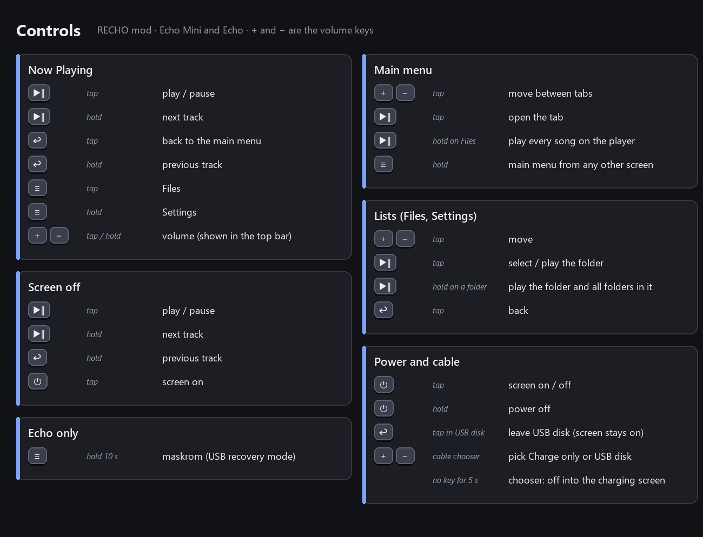
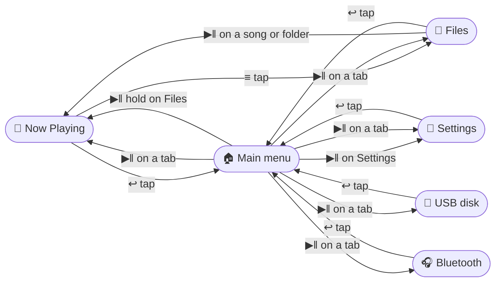
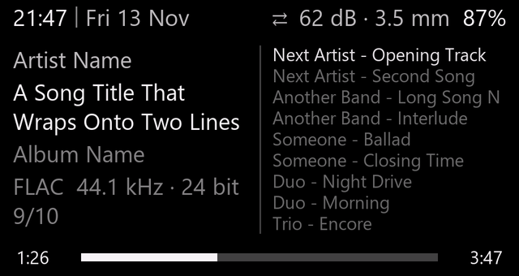
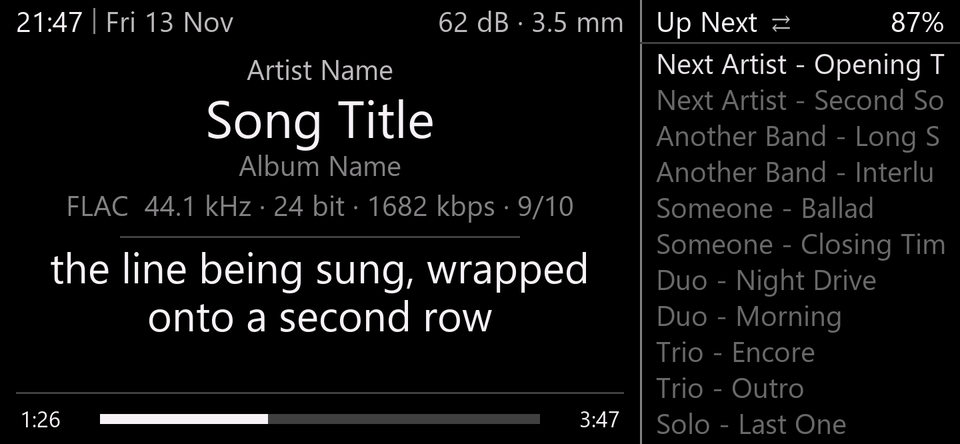
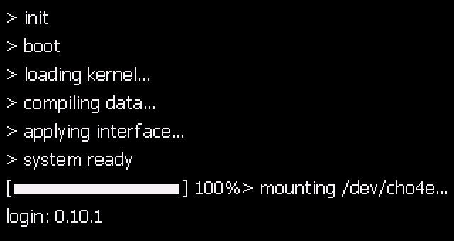

# Controls

How the buttons work with this mod, on the **Echo Mini** and the full-size **Echo**. Both players use
the same buttons, except for the Echo-only recovery hold.



<sub>Key names used below: <kbd>▶‖</kbd> play/pause · <kbd>≡</kbd> menu · <kbd>↩</kbd> back ·
<kbd>+</kbd> <kbd>−</kbd> volume · <kbd>⏻</kbd> power. A **tap** is a short press; a **hold** is a press
of about half a second.</sub>

---

## Getting around



Holding <kbd>≡</kbd> on any screen other than Now Playing goes straight to the main menu.

---

## Now Playing

| Key | Tap | Hold |
|:---:|---|---|
| <kbd>▶‖</kbd> | play / pause | next track |
| <kbd>↩</kbd> | back to the main menu | previous track |
| <kbd>≡</kbd> | Files | **add the song to favourites, or take it off** |
| <kbd>+</kbd> <kbd>−</kbd> | volume up / down | keeps changing |

A red heart after the song title means the song is a favourite. A message confirms each change
(*Added to favourites* / *Removed from favourites*). See [Favourites](#favourites) below.

The volume shows in the top bar before the output, for example `62 dB · 3.5 mm`, or
`62 dB · BT <headphones>` in green on Bluetooth. RECHO's quietest step reads 0 dB. The battery %
(Mini: top bar, Echo: Up Next) is green while the cable is in, amber at 35 % or less, red at 15 % or
less.

## Favourites

Hold <kbd>≡</kbd> on Now Playing to add the song playing to your favourites; hold it again to take it
off. The list is a playlist file, **`FAVORITE.M3U`**, at the top of the player's drive:

```
#EXTM3U
Halsey - Ashley.flac
Music/Album/Song.flac
```

- **It stays.** Firmware updates only write the firmware area, never your music drive, so the list
  survives updates (and a trip to Podium and back).
- **Phones and computers read it.** Copy your music with the same folders and `FAVORITE.M3U` next to
  them; Poweramp, Musicolet, VLC, AIMP and most players open it as a playlist. It does not merge into an
  app's own "liked songs", which each app keeps to itself.
- **You can edit it** in any text editor: one song per line, as its path from the top of the drive.
  Edit it on the computer, plug the player back in, and the hearts follow.
- **Play them:** open **Files**; under **Internal** and **SD card** there is a third row,
  **Favourites**. Press <kbd>▶‖</kbd> (tap or hold) on it: the player queues every song in
  `FAVORITE.M3U` and opens Now Playing; shuffle, repeat, Up Next and resume work as for any folder.
  Nothing has to be made on the drive for it.
- **Limits:** songs on the internal drive only (not an SD card), and up to 4 KB of list, about 50–60
  songs; past that the player says *Favourites full* instead of risking the drive.

## Main menu

The menu is one row of tabs: **Files · USB disk · Now Playing · Bluetooth · Settings**. It opens on
Now Playing.

| Key | Tap | Hold |
|:---:|---|---|
| <kbd>+</kbd> <kbd>−</kbd> | move between tabs | |
| <kbd>▶‖</kbd> | open the tab | **on Files: play every song on the player** |
| <kbd>↩</kbd> | back | |

> [!TIP]
> **Hold <kbd>▶‖</kbd> on the Files tab** to queue everything on the internal storage and start
> playing. It does the same as holding <kbd>▶‖</kbd> on *Music* at the top of Files: the player opens
> Files for a moment, queues every folder, then switches to Now Playing. Play mode (shuffle, repeat)
> applies as usual.

## Files and Settings (lists)

| Key | Tap | Hold |
|:---:|---|---|
| <kbd>+</kbd> <kbd>−</kbd> | move up / down | keeps moving |
| <kbd>▶‖</kbd> | open a folder, play a song (its folder becomes the queue), change a setting | **on a folder: play it and every folder inside it** |
| <kbd>↩</kbd> | back | |

Holding <kbd>▶‖</kbd> on **Music** or **SD card** at the top level of Files plays the whole drive.

## With the screen off

| Key | Tap | Hold |
|:---:|---|---|
| <kbd>⏻</kbd> | screen on | power off |
| <kbd>▶‖</kbd> | play / pause | next track |
| <kbd>↩</kbd> | | previous track |
| <kbd>+</kbd> <kbd>−</kbd> | volume | keeps changing |

These are RECHO's own; the mod's menu gestures only work while the screen is on.

## Power, cable and USB

| Situation | What to press | What happens |
|---|---|---|
| Any time | <kbd>⏻</kbd> tap | screen on / off |
| Any time | <kbd>⏻</kbd> hold | power off (with a cable: the charging screen) |
| Cable plugged in | <kbd>+</kbd> <kbd>−</kbd>, then <kbd>▶‖</kbd> | choose **Charge only** or **USB disk** |
| Cable plugged in | nothing for 5 s | Charge only: the player powers off into the charging screen |
| USB disk mode | <kbd>↩</kbd> tap | leave USB disk and go to the main menu; the screen stays on |
| Charging screen | <kbd>⏻</kbd> tap | show the screen again |
| Charging screen | <kbd>⏻</kbd> hold | start the player |

> [!NOTE]
> Leaving USB disk waits until you let go of the key, so the press does not also reach the player
> (before, the power press that ended USB mode also switched the screen off).

## Echo only: recovery

| Key | Hold | What happens |
|:---:|---|---|
| <kbd>≡</kbd> | 10 s, any screen | the Echo restarts into **maskrom** (the boot ROM's USB recovery mode) |

Use it only to recover with `rkdeveloptool`; see [10-install-and-recovery.md](10-install-and-recovery.md).
The cold entry described there (paperclip reset + keys) is the more reliable one.

---

## The screens

### Echo Mini: Now Playing



| Area | Shows |
|---|---|
| Top bar | time · date, play mode, output and volume, battery % |
| Left | artist, song (wraps onto two lines), album, then the file details: format, sample rate, bits, queue position (wrapped at the dots) |
| Right | **Up Next**: the next 9 songs in play order, the next one brighter |
| Bottom | elapsed time, progress bar, length (red while paused) |

### Echo: Now Playing



| Area | Shows |
|---|---|
| Top bar | time · date, output and volume |
| Picture | artist and song (doubled when they fit), album, file details with average bitrate and queue position, then the **lyric line being sung** at 1.5x, wrapped onto two rows when long |
| Strip | progress bar under a thin line; on other screens the file details and the progress bar |
| Up Next | play mode, battery % (green while charging, amber ≤ 35 %, red ≤ 15 %), the next 11 songs |

Lyrics come from a `.lrc` file with the same name as the song, in the same folder
(`Song.flac` + `Song.lrc`). See [06-echo-ui.md](06-echo-ui.md#lyrics).

### Boot screen (both)



Drawn with RECHO's large font, the one the *Power off* message uses. The glyphs travel with the mod
because RECHO draws this screen before it loads its fonts.

<sub>The two Now Playing pictures are drawn by `tools/render_docs.py` from the coordinates in
`patches/ui_np.c`; the text uses a stand-in typeface and made-up track data. The boot picture is
pixel exact.</sub>
